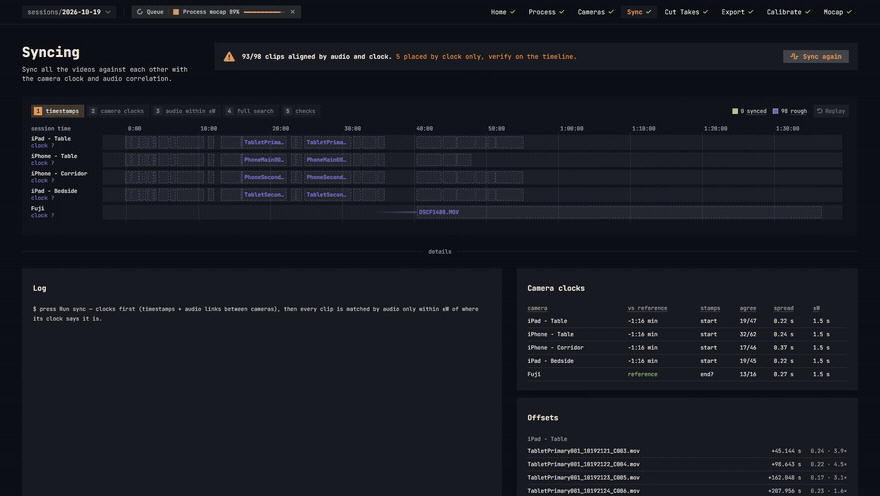
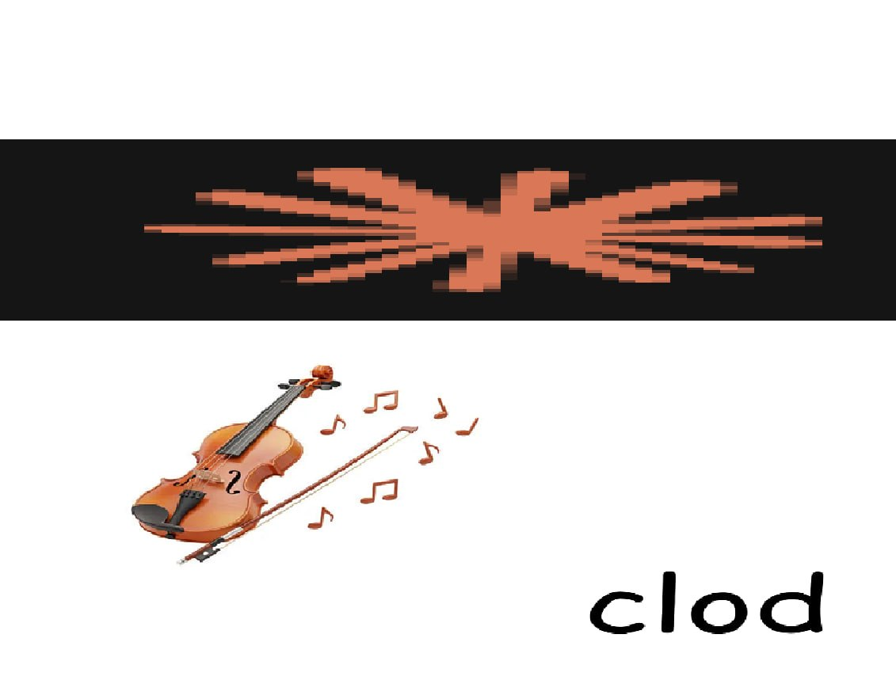

# Batlejka

**Sync, cut, capture.**

> Batlejka (Belarusian *Батлейка*, from "Bethlehem") is the old Belarusian puppet theatre: a
> wooden box of two storeys carried from house to house at Christmas, with the nativity
> played upstairs and the village comedy downstairs, the puppets on rods, the puppeteer
> hidden behind the box. In this one, the puppet is you.

Drop the footage from a multi-camera mocap session into a folder, and Batlejka lines the
clips up on one timeline, lets you cut them into takes, exports every take as
frame-matched videos, and runs [FreeMoCap](https://freemocap.org) on them to get 3D
skeletons. One local web page, from raw phone clips to a `.blend` file.



> Batlejka is a wrapper around FreeMoCap, not a replacement for it. The markerless
> capture, the calibration and the 3D tracking are all FreeMoCap's work; this tool only
> gets the footage into the shape FreeMoCap wants and runs it for you. I made it for my
> own animation pipeline, with my own cameras, and share it as is. If it is useful to you,
> please support the people who made the hard part possible:
> [freemocap.org](https://freemocap.org) · [github.com/freemocap/freemocap](https://github.com/freemocap/freemocap).

## What it does

- **Any cameras, no timecode.** Phones, tablets, an action camera, a mirrorless body that
  records one long clip while the phones record one clip per take: all of them go on one
  session timeline. Each camera's clock is worked out from its timestamps and audio, then
  every clip is placed by audio within a small window, so looping music or a repeated
  clap can't pull a clip a bar off. You can see it happen.
- **Cut takes like in an editor.** Scrub a multi-camera grid, mark in and out, drag takes
  on the timeline, rename them, or let it propose takes from the clusters of clips. The
  keyboard works the way you expect (space, arrows, I / O / N, J / L).
- **Exports FreeMoCap can read as they are.** One folder per take, one video per camera,
  all with exactly the same frame count and frame rate, rotated the right way up, black
  where a camera started late or stopped early.
- **FreeMoCap, installed and run for you.** The Setup card installs a pinned FreeMoCap
  into its own environment. Calibrate from a ChArUco take, keep several calibration
  profiles, tick the takes, press Process, and watch the skeleton in a 3D viewer.
  Optionally it writes a `.blend` per take.
- **Everything is a folder.** `sessions/<name>/source/` is never modified. Exports go to
  `sessions/<name>/output/<take>/`. The session's state is one JSON file under
  `.preprocess/`; everything else in there (thumbnails, proxies, sync audio) is a cache
  that is rebuilt when deleted.

## Screens

| | |
|---|---|
|  |  |
| **Sync.** Clips start where their timestamps put them and click into place as the audio is matched. | **Cut Takes.** A camera grid, a timeline with waveforms, takes on the left, an inspector on the right. |
|  |  |
| **Export.** Takes × cameras, with the coverage of every cell, and the output settings. | **Mocap.** FreeMoCap's settings in plain words, a take table, and a skeleton viewer per processed take. |

## Getting started

You need Windows (it runs elsewhere too, but Windows is where it is used), Python 3.12 or
newer, `ffmpeg` and `ffprobe` on `PATH`, and a Chromium browser (Chrome or Edge). An
NVIDIA GPU speeds up proxies and exports but is optional. The Mocap step needs `git` and
about 6 GB of disk for FreeMoCap's environment; the Setup card installs the rest.

1. Double-click **`run.bat`**. The first run creates a virtual environment and installs
   the Python requirements; then it starts the server on `http://127.0.0.1:8765/` and
   opens the browser.
2. On the Home screen, create a session and drop your clips into its `source/` folder
   (a subfolder per camera is optional). Press **Re-scan**.
3. Walk the steps in the header: **Process → Cameras → Sync → Cut Takes → Export →
   Calibrate → Mocap**. A step unlocks once the one before it has done its part.

The **[user guide](docs/README.md)** has a page per step with every setting explained
where it sits in the UI.

## Known limitations

- Made for one person's setup: a few phones or tablets and one camera, all recording the
  same room with sound. Cameras without audio are placed by their clocks only.
- Clips need timestamps (`creation_time`) or audio. A clip with neither goes to the end of
  the timeline for you to place by hand.
- The Mocap step is FreeMoCap 1.8.2, headless, with MediaPipe tracking on the CPU: a
  one-minute take with five cameras takes several minutes.
- A camera that was not in the calibration can't be processed; a take can use fewer
  cameras than the calibration, not more.
- One job of each kind at a time per session, in one browser tab per server. Files that
  another program has open (FreeMoCap's GUI, a player) can't be re-exported until they
  are closed.
- The UI is Chromium only, and the server listens on `127.0.0.1` unless you tell it
  otherwise. Keep it that way: it serves your footage.

## Running it by hand

```
python -m venv .venv
.venv\Scripts\pip install -r requirements.txt
.venv\Scripts\python -m mocap_preprocess [--port 8765] [--sessions-dir ./sessions] [--no-browser]
```

Set `MOCAP_FFMPEG` / `MOCAP_FFPROBE` if the tools aren't on `PATH`. The Python package
keeps its working name, `mocap_preprocess`.

## For developers

```
pip install -r requirements-dev.txt
python -m pytest                 # ~2 min: builds a synthetic session with ffmpeg and runs everything on it
python -m pytest -m fmc          # opt-in: FreeMoCap's self-test through the API (needs the env installed)
```

Code map: `server.py` and `routes_*.py` (the API), `pipeline.py` (scan, fps check,
process, proxies), `grouping.py`, `syncing.py`, `takes.py`, `exporter.py`,
`previews.py` (Cut Takes' preview videos), `ffmpeg_tools.py`, `session_store.py`
(locked, atomic `session.json`), `jobs.py` (background jobs), `setup_check.py` (the Setup
card and GPU probes), `fmc/` (FreeMoCap: `env.py` install and check, `runner.py` runs
`fmc_headless.py` inside its env, `mocap.py` calibration profiles and processing),
`static/` (the UI: plain ES modules, no build step; one module per step under `screens/`,
canvas views in `timeline.js`, `syncviz.js`, `skeleton3d.js`, `frameview.js`).
`tools/docshots.py` captures the screenshots and GIFs for the docs with the footage
pixelated.

## License

Batlejka is licensed under the [GNU AGPL v3](LICENSE). Some bundled pieces are under their
own licenses (Font Awesome Free, JetBrains Mono); FreeMoCap and ffmpeg run alongside and
are not part of this repository. See [THIRD_PARTY_NOTICES.md](THIRD_PARTY_NOTICES.md).

## AI Disclosure



Most of the code was written with the help of Anthropic's Claude Opus and Fable.
