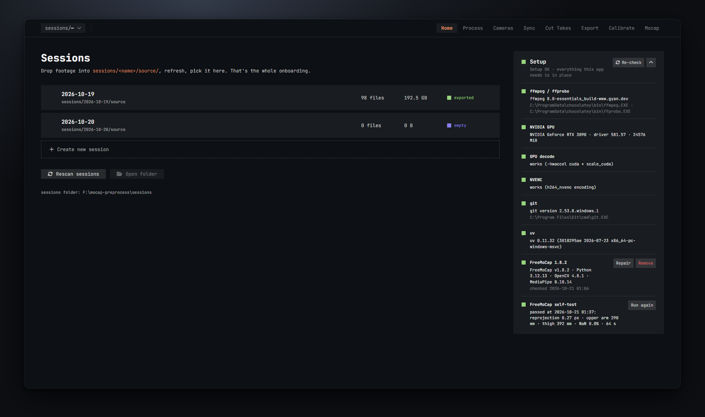
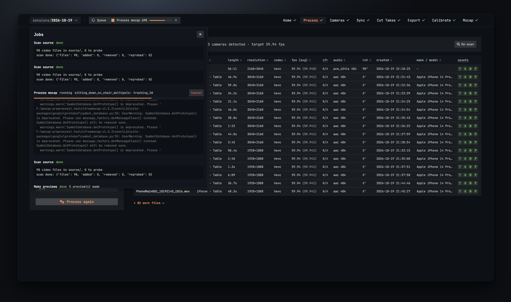

# Home and Setup

The Home screen is where you pick a session and where the Setup card checks the machine. You come back here to switch sessions or to install FreeMoCap.



## Sessions

A session is one recording day, or one shoot. On disk it is a folder under the sessions folder:

```
sessions\<name>\source\
```

- Drop all the footage of the shoot into `source\`. Every camera's files go in there together.
- Subfolders are optional. If you make one folder per camera inside `source\`, each subfolder becomes one camera and the folder name becomes the camera name. That is the surest way to group files.
- `source\` is never modified. The app only reads it. Everything it builds goes into other folders next to it.
- The bottom of the page shows where the sessions folder is on this machine, for example `sessions folder: F:\mocap-preprocess\sessions`.

### The sessions list

Each row shows the session name, its path, how many files are in `source\`, their total size, and how far along the session is:

| State | Meaning |
| --- | --- |
| empty | `source\` has no files yet. |
| new | Files are there, but nothing has been processed. |
| processed | The Process step has run. |
| synced | The Sync step has run. |
| exported | At least one take has been exported. |

- Click a row to open that session. The header switches to it and the app scans `source\` for new or changed files.
- Double-click a row to open it and go straight to the Process step.

### Creating a session

1. Click **Create new session**.
2. Type a name. The preview under the box shows the folder it will make (`sessions\<name>\` with `source\` inside).
3. Press Enter or click **Create**. Esc or **Cancel** gives up.

A name cannot contain `< > : " / \ | ? *`, cannot start with a dot, and is trimmed to a folder-safe form. Spaces become dashes. If the name already exists you get the note *a session with this name already exists* and the button stays off.

After creating it, drop your footage into the new `source\` folder, then come back and click **Rescan sessions** so the file count updates.

### Other buttons

- **Rescan sessions** re-reads the sessions folder. Use it after adding a session folder by hand or after copying footage in.
- **Open folder** opens the current session's `source\` folder in Explorer.

### Switching sessions from the header

The box at the top left (`sessions/<name>`) is a menu. Click it to see every session with its file count, pick another one, or:

- **New session…** jumps to Home with the create form open.
- **Open session folder** opens the session's folder in Explorer.
- **Rescan sessions** does the same as the button on Home.

## The Setup card

The Setup card lives on the right of the Home screen. It has one row per thing the app needs. Each row has a small square: green is fine, orange needs attention, red failed, grey is not applicable. A row with a job running shows a progress bar instead. The square in the card's header pulses gently when everything is in place.

The header sums it up: *Setup OK · everything this app needs is in place*, or *N things need attention: …*. Click the chevron to fold the card; it stays open by default.

- **Re-check** runs every check again, including the GPU tests and FreeMoCap's own check. Use it after installing ffmpeg or a driver. While FreeMoCap is being installed or repaired, its own check is skipped until that job is done.

### The rows

**ffmpeg / ffprobe**
The video tools the whole app runs on. Green shows the version and the paths. Red means one of them is not on your PATH; the row tells you how to install it. Nothing works without them, and a red banner appears at the top of every screen.

**NVIDIA GPU**
The GPU found on the machine, its driver and memory. Grey with *none found — everything runs on the CPU* is fine; you just do not get the GPU options.

**GPU decode**
A real test: the app decodes a short clip on the GPU the same way an export would. *works* turns on the **GPU decode** option on the Process step. *test failed* means the option is turned off there, with the reason; usually an old driver or an ffmpeg build without CUDA. The CPU path still works.

**NVENC**
The same kind of test for GPU encoding. *works* lets you pick the `h264_nvenc` encoder on the Export step, and new sessions start with it. *test failed* turns that encoder off on Export.

**git**
Only needed to install FreeMoCap, which is fetched from GitHub. Orange if missing and FreeMoCap is not installed yet; grey once FreeMoCap is in place.

**uv**
The installer the app uses to build FreeMoCap's own Python environment. It comes with the app's packages, so it should always be there once `run.bat` has run.

**FreeMoCap 1.8.2**
The pinned FreeMoCap that the Calibrate and Mocap steps run. It lives in `.tools\freemocap-v1.8.2\` next to the app, with its own Python 3.12, separate from any FreeMoCap you already have. It never touches your own FreeMoCap data.

- *not installed*: click **Install**. It downloads about 3 GB and needs about 6 GB free on the drive. Installing takes a few minutes; the row shows the progress and the Queue pill shows it too. The check that ends the install is slow (FreeMoCap's first start); wait for the row to turn green.
- Green: shows the FreeMoCap, Python, OpenCV and MediaPipe versions and when it was last checked. **Repair** rebuilds the environment from the app's lock file; use it when the check fails. **Remove** deletes the whole `.tools\freemocap-v1.8.2\` folder after you confirm. Your sessions, exports and processed takes are not touched. Installing again downloads the 3 GB again.
- Red (*needs a repair*): installed but its check fails. Click **Repair**.

**FreeMoCap self-test**
Downloads FreeMoCap's own 3-camera sample (about 38 MB), calibrates it and tracks it. It takes a few minutes. *passed* shows the numbers it got: the reprojection error in pixels, the upper arm and thigh lengths it measured, how many points were missing (NaN), and how long it took. Run it once after installing, and again after a **Repair**. Until FreeMoCap is installed, the row says *install FreeMoCap first*.

Only one setup job can run at a time; the other buttons are greyed out while one runs.

## The job queue

Long work (scanning, processing, syncing, exporting, calibrating, mocap) runs in the background. You can keep using the app, switch steps, or switch sessions.

### The Queue pill

The pill in the header, next to the session name, shows the newest running job: its name, its percentage and a thin progress bar. Once nothing runs it shows the last job and its result (done, error, cancelled). If several jobs run at once it says `(+N)`.

- The small **x** on the pill cancels the running job.
- Click the pill to open the Jobs drawer.

Finished jobs also pop up a short message for a few seconds: *Export takes done*, or a red one with the error.

### The Jobs drawer



The drawer lists the last few jobs, newest first. For each one you see:

- its name and status,
- its last message,
- a **Cancel** button while it runs,
- the error, if it failed,
- its log: what it did, line by line. A mocap job's log includes FreeMoCap's own output.

Close it with the **x** in its corner or by clicking the pill again.

### Cancelling

Cancel stops the job as soon as it can. What was already written stays:

- a cancelled export keeps the files it has finished,
- a cancelled mocap run keeps the takes it had finished; the one it was on and the ones it had not reached stay as they were, so just process them again.

Only one job of each kind runs per session at a time. If you click a button and nothing happens, look at the pill: the same kind of job is probably still running.
