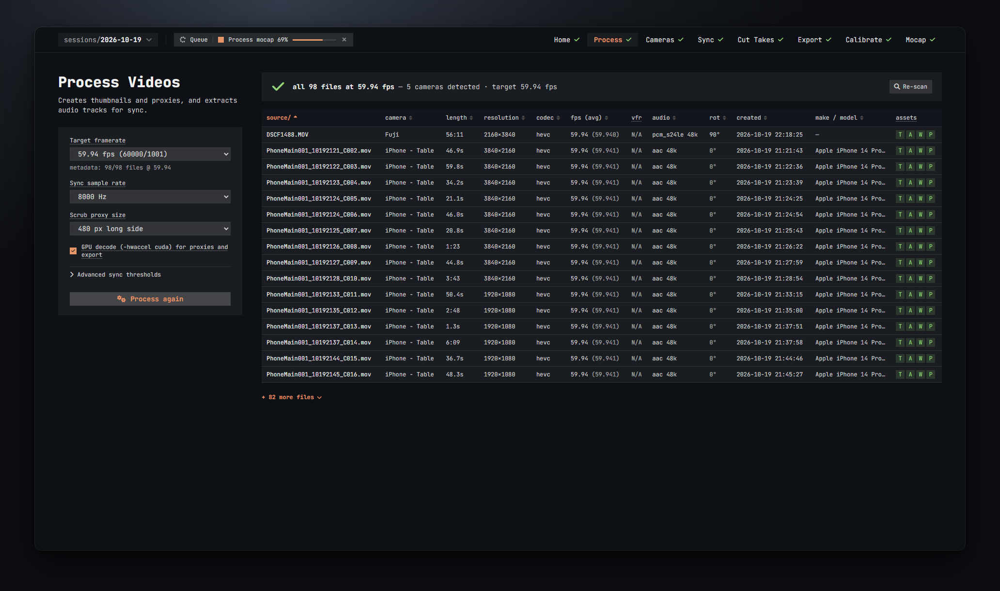
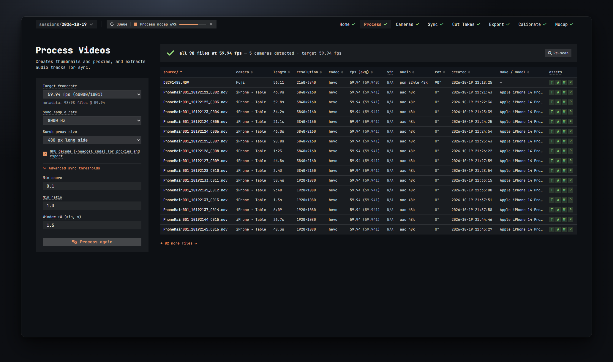

# Process

The Process step reads your source files, checks their frame rates, and builds everything the later steps need: thumbnails, sync audio, waveforms and low-resolution scrub proxies. It also groups the files into cameras.

## The scan

The app scans `source\` as soon as you open a session. It reads every video file's length, resolution, codec, frame rate, audio, rotation tag, creation time and camera make/model. Files that were added, removed or changed since last time are picked up; the rest are kept.

- Click **Re-scan** (top right of the banner) after you add or remove files in `source\`.
- If `source\` is empty the right side says so: drop the raw clips there and hit Re-scan.

## The frame-rate banner

The banner above the table sums up the scan:

- A green tick with *all N files at X fps* means every file matches the target frame rate.
- *N ok · M off-target* means some files differ. Each problem is listed under it with the files it concerns (up to six names, then *+N*).
- It also says how many cameras were detected and what the target frame rate is.

The warnings you can see:

| Warning | What it means | What to do |
| --- | --- | --- |
| *N file(s) at X fps instead of Y* | These files run at another rate than the target. The note says what happens on export: frames dropped or duplicated evenly (for example 60 vs 59.94), or *~N frames of drift per minute* when the rates are close but not a clean multiple. | Nothing. Every export is conformed to the target rate. If most of your files are at the "wrong" rate, change the target instead. |
| *N file(s) look variable-frame-rate* | The file's average rate differs from its nominal rate. Phones do this. | Nothing. They are conformed to a constant rate on export. |
| *N file(s) without audio* | No sound track. | They cannot be audio-synced. Sync places them by their camera clock. Check their position in Cut Takes and nudge if needed. |
| *N file(s) without a video stream* (red) | Audio-only or broken files. | They are ignored. |
| *N file(s) could not be probed* (red) | ffprobe could not read the file. | See the scan log in the Jobs drawer. Usually a damaged or unfinished file. |

## Settings

The card on the left holds the settings of this session. They are saved as soon as you change them.

**Target framerate**
The frame rate every exported take gets. Files at other rates have frames dropped or duplicated to match. The app prefills it with the most common rate in your files (weighted by length); the note under the box shows how many files already match, for example *metadata: 98/98 files @ 59.94*. Pick another standard rate from the list, or choose **custom…** and type one, as a number or a fraction like `30000/1001`. Once you set it yourself the note says *set by you* with a **reset** link that goes back to the automatic choice.

**Sync sample rate**
The rate each clip's audio is resampled to for matching. Default 8000 Hz, which is plenty for sync. Higher rates are slower and rarely help.

**Scrub proxy size**
The long side of the small copy made of each video for scrubbing and playback in Cut Takes. Default 640 px. Smaller proxies build faster and scrub more smoothly; larger ones look better in the tiles. Exports always read the original files, so this does not affect quality.

**GPU decode (-hwaccel cuda) for proxies and export**
Decodes the source videos on the NVIDIA GPU while making proxies and exporting. A file that fails on the GPU is retried on the CPU, so it is safe to leave on. The box is greyed out with *(unavailable on this machine)* when the GPU decode test in Setup failed.

### Advanced sync thresholds

Click **Advanced sync thresholds** to show three numbers the Sync step uses. The defaults work for normal sessions with a clap at the start of each take. Change them only when Sync keeps placing clips wrongly.

**Min score** (default 0.1)
The lowest audio-match strength (0 to 1) that counts as a match. Inside the search window a quarter of this is enough, because the window already rules out far-away look-alikes. Lower it if clips with quiet audio stay unplaced; raise it if wrong matches get accepted.

**Min ratio** (default 1.3)
How many times stronger the best match must be than the next-best one further than 0.1 s away. This is what protects against repeating sounds such as looping music. Raise it when music keeps pulling clips a bar off.

**Window ±W (min, s)** (default 1.5, from 0.2 to 30)
Each clip's audio is only searched within this many seconds of where its camera clock puts it. The window grows on its own to three times a camera's clock spread when that is larger. Make it bigger if a camera's clock is erratic; smaller if looping music still fools it.

## Processing

**Process source files** (or **Process again** once it has run) starts the processing job. It:

1. makes one thumbnail per file,
2. computes a small "background" fingerprint per file, used to tell identical devices apart,
3. extracts the sync audio and a waveform for the timeline,
4. groups the files into cameras (see [Cameras](03-cameras.md)),
5. places every clip roughly on the timeline by its creation time,
6. then builds the scrub proxies in the background, shortest clips first.

Progress shows under the button: the scan, the processing and the proxy build each get their own bar. You can move on to Cameras and Sync while the proxies are still building; Cut Takes shows a still thumbnail with *proxy building…* for any file whose proxy is not ready yet.

Run **Process again** after adding files to `source\`, or after changing the sync sample rate or the proxy size. Already-built assets are reused where they still match.

## The file table

Every file in `source\`, one per row. Click a column header to sort by it; click again to flip the order. Headers with a dotted underline have an explanation on hover.

| Column | What it shows |
| --- | --- |
| source/ | The file's path inside `source\`. |
| camera | The camera it was grouped into, once processing has run. |
| length | Duration. |
| resolution | The picture size, after the file's own rotation tag. |
| codec | The video codec (for example `hevc`). |
| fps (avg) | The nominal frame rate, with the measured average in brackets. Orange when it differs from the target. |
| vfr | *VFR* when the file looks variable-frame-rate, otherwise *N/A*. |
| audio | The audio codec and sample rate, or *none*. |
| rot | The rotation tag in the file (0°, 90°, 180°, 270°). |
| created | The creation time stamped in the file. |
| make / model | The camera make and model, when the file says. |
| assets | What processing has made for this file: **T** thumbnail, **A** sync audio, **W** waveform, **P** scrub proxy. Lit letters exist; dim ones are missing. *probe failed* means the file could not be read. |

Only the first 16 rows are shown. Click **+ N more files** to see the rest, and **Show fewer** to fold them again.
