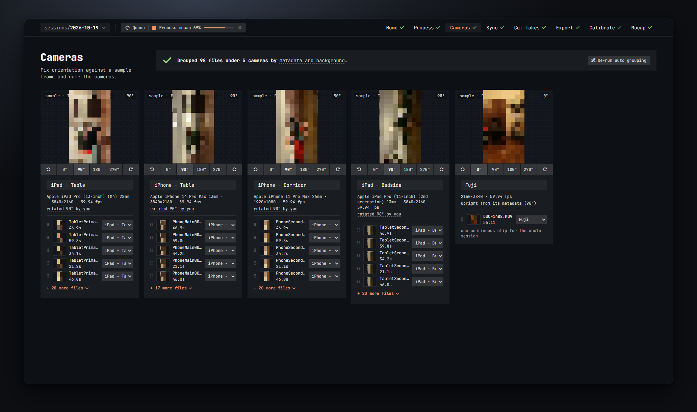

# Cameras

The Cameras step shows one card per camera. Here you turn each camera's picture upright, give it a name, and fix the grouping if a file landed on the wrong camera. Everything on this screen saves itself a moment after you change it.

## How the files were grouped

The banner at the top says how the cameras were made, for example *Grouped 98 files under 5 cameras by metadata and background.* Hover the underlined words for the explanation:

- **metadata and background**: files with the same make, model, codec, resolution and frame rate go together. Two identical devices (two iPhones of the same model) are told apart by their static background and by clips that could not have been recorded at the same time by one camera.
- **subfolder**: each subfolder of `source\` became one camera. This wins over everything else.
- **you**: cameras you made by moving files into a new camera.

The banner also counts files you moved by hand, and warns about two things:

- *without a camera — N files: pick a camera for them below*. These files sit in an **Unassigned** card at the end. Use the dropdown on each to put it somewhere.
- *name used twice — <name>: export file names would collide*. Two cameras have the same name. Rename one; the export names files after the camera.

**Re-run auto grouping** throws away the current cameras, names and rotations and groups everything again from scratch. It asks first. Use it when you moved files around and made a mess, or after adding many new files.

## A camera card

Each card has, from top to bottom:

**The sample frame**
A thumbnail from the camera's first clip, taken about a third of the way in (the chip in the corner says which file and where). The chip on the right shows the current rotation.

**The rotation bar**
Turn the camera until the person stands upright in the sample frame:

- the left and right arrow buttons turn by 90° counter-clockwise or clockwise,
- the **0° / 90° / 180° / 270°** buttons set the angle directly.

Rotation is applied on screen only, here and in Cut Takes. Nothing is re-encoded until you export; the exported videos are turned by this angle. So turning is instant and you can change your mind at any time before exporting.

**The name**
Type the camera's name in the box. It becomes the file name of every export of this camera (`<name>_synced.mp4`) and the camera name FreeMoCap sees, so keep it short and keep it the same across sessions if you can. The box turns red with *name used twice* if another camera has the same name.

**The info line**
Make and model, picture size and frame rate, and a note about rotation:

- *upright from its metadata (90°)*: the file carries a rotation tag, so it is shown upright already. If you turned it further it adds *· rotated 90° more by you*.
- *rotated 90° by you*: no tag, you turned it.
- *no rotation tag — check this one* (orange): a phone or tablet without a rotation tag. Phones often record sideways without saying so, so look at the sample frame.
- *no rotation metadata*: a regular camera without a tag. Usually fine.

**The file list**
The camera's clips with a mini thumbnail, name and length. The first five are shown; **+ N more files** shows all of them. A camera with a single clip gets a note: *one continuous clip for the whole session* when that clip covers most of the session, otherwise *one clip*.

## Moving files between cameras

Two ways:

- **Drag**: grab a file row by its grip and drop it on another card. The card lights up while you hover it.
- **The dropdown**: each file row has a dropdown listing every camera. Pick one. Pick **+ new camera** to make a fresh camera (named `cam1`, `cam2`, … whichever is free) with just this file in it.

A moved file shows *moved here from <camera>* under its name so you can see what you changed. Moving the last file out of a camera removes that camera.

Moving a file does not change its position on the timeline. If the clip was already synced, it keeps its offset.

## When to come back here

- After **Process again** with new files: new files are grouped into the existing cameras where they fit, or into a new camera. Check the new ones.
- Before **Export**: make sure every camera has the right name and rotation, since both end up in the exported files.
- Camera names are also what the calibration remembers. If you rename a camera after calibrating, the Mocap step will tell you the take's cameras are not in the calibration. Keep names stable once you have calibrated.
