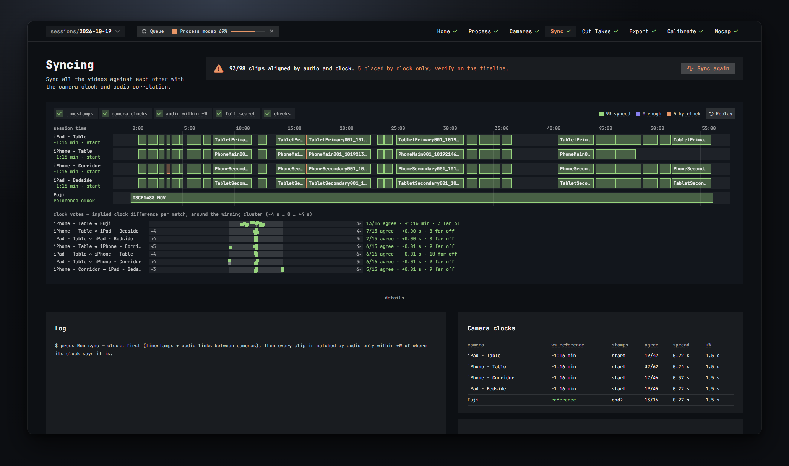
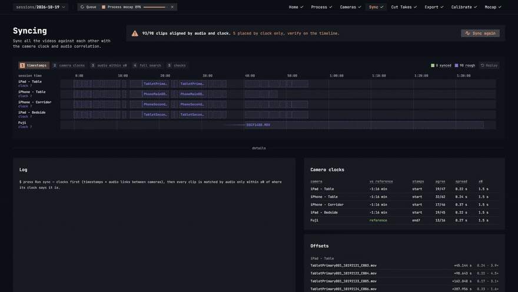
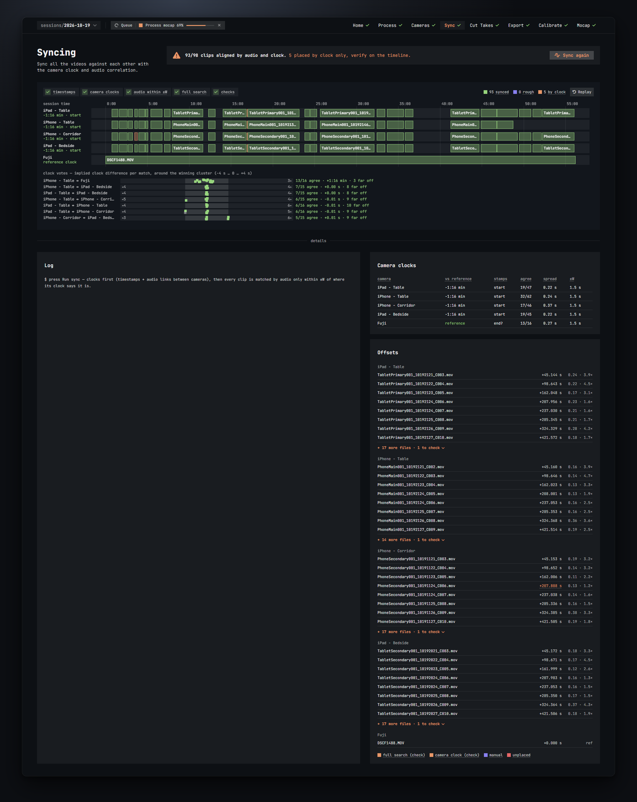

# Sync

The Sync step puts every clip of every camera on one shared timeline, so that the same moment lines up across cameras. It does the work; you check the few clips it was not sure about.

## What sync does, in plain terms

Every camera has its own clock, and every clip carries a time stamp from that clock. Phones that sync their time over the network agree to the second; a standalone camera can be minutes or hours off. And some cameras stamp the start of a recording, others the end.

So sync works in two stages:

1. **Camera clocks.** It compares audio between clips of different cameras that were recorded around the same time, and from every match learns how far one camera's clock is from another's. The camera with the longest file is the reference; the others are chained to it through the strongest links. It also works out, per camera, whether the stamp marks the start or the end of a clip.
2. **Audio within ±W.** Once each clip's rough position is known from its corrected clock, its audio is matched only within a small window (±W, 1.5 s by default) around that position. Overlapping clips vote together. The window is what stops looping music or a steady beat from pulling a clip one bar off.

Clips that cannot go through this path get a fallback:

- a clip whose camera clock could not be linked to the others is matched against the whole session (*full search*),
- a clip with no clear audio match stays where its clock puts it (*camera clock*),
- a clip with no audio also stays where its clock puts it,
- a clip with nothing to go on (no audio, no usable time stamp) is left unplaced.

At the end it checks that no two clips of one camera overlap and that no clip sits further than ±W from its camera clock, and flags the ones that do. Clips you placed by hand are never moved unless you ask.

## Running it

The card at the top right shows where syncing stands and holds the button:

- **Run sync** starts it. Later it reads **Sync again**. While it runs the button becomes **Cancel**.
- Before the first run the card says *Not synced yet. Offsets are provisional (creation time)*: the timeline you see in Cut Takes is only a rough guess from the time stamps until you sync.
- **re-sync N manual file(s) too**: this tick appears when some clips have a manual offset (you nudged them or re-synced them by hand in Cut Takes). Sync leaves those alone unless you tick it.

How long it takes depends on the number of clips. The live view animates as it goes.

## The status banner

After a run, the card says how it went:

- *All N clips aligned.* Everything was placed by audio. Nothing to check.
- *X/N clips aligned by audio and clock.* followed by what needs a look:
  - *N placed by full search only, verify on the timeline.* Their camera clock was not usable. Usually right, but check them.
  - *N placed by clock only, verify on the timeline.* No clear audio match; they sit where the clock puts them. Check them.
  - *N flagged (see Offsets).* The checks found something: an overlap within one camera, or a clip far off its clock.
  - *N unplaced.* (red) These have no position at all. Set their offset by hand in Cut Takes.

## The live view

The big card shows one lane per camera with its clips as bars, on session time. During a sync the bars move as the job works; after a sync they show the result.

### Colours

The legend at the top right counts the clips by state:

| Colour | Label | Meaning |
| --- | --- | --- |
| green | **synced** | Placed by audio: the reference clip, audio matches within ±W of the camera clock, and full-search matches. |
| blue-violet | **rough** | Still at the spot its camera clock or raw time stamp suggests, waiting for an audio match. Only seen while a sync runs. |
| orange | **by clock** | No clear audio match, left where the camera clock puts it. Check these on the timeline. |
| violet | **manual** | You placed this clip by hand. Sync keeps it unless you tick *re-sync manual files*. |
| red | **unplaced** | Neither an audio match nor a usable clock. It has no position yet. |

Full-search matches are drawn with a dashed orange outline, so you can spot them even though they count as synced.

Under each camera name the lane shows its clock: *reference clock* for the reference camera, otherwise how far its clock is ahead or behind and whether it stamps the *start* or *end* of a clip (for example *−1:16 min · start*). *clock assumed* means no audio link could be made and the nearest clock was used; *clock from manual* means its clock comes from an offset you set by hand; *clock ?* shows while it is still being worked out; *no timestamps* means the files carry none.

Hover a bar to see the clip name, its time, and how it was placed. Clips with no time stamp at all wait in a *no timestamp* column at the right edge until the audio places them.

### The phase strip

The five chips at the top left show which stage is running, with a tick on the ones already done:

1. **timestamps**: loads each clip's audio and its creation time.
2. **camera clocks**: matches audio between cameras to learn each clock's offset.
3. **audio within ±W**: matches every clip only within ±W of its corrected clock position.
4. **full search**: clips whose camera could not be linked are matched against the whole session.
5. **checks**: flags clips that overlap another clip of the same camera, or sit outside ±W of their clock.

### Clock votes

Under the lanes, one row per pair of cameras shows the *clock votes*: every audio match between the two cameras implies a clock difference, and each one is a small square on a strip of ±4 s around the winning cluster. Squares inside ±1 s are coloured (they agree); grey ones are off. The text on the right reads like *13/16 agree · +1:16 min · 3 far off*: how many matches agreed, the clock difference that won, and how many matches were thrown out. A pair with few agreeing votes is a weak link; look at its clips.

### Replay

**Replay** (top right of the card) plays the last sync again as an animation: clips start at their raw time stamps, jump when their camera clock is solved, then click into place one by one as the audio matches them, with a flash on landing. It is a quick way to see what the sync did and which clips moved far.

## Details

Below the live view are three cards.

### Log

The sync job's log, line by line: which camera became the reference, every clock link with its votes, every clip's match with its score, and the warnings from the checks. When a clip ended up somewhere odd, this is where you find out why. Before the first run it tells you what pressing Run sync will do.

### Camera clocks

One row per camera, with what was learned about its clock. Hover a camera name to see how its clock was tied to the reference: *reference*, *audio links*, *full search*, *assumed (median clock)* or *your manual offset*.

| Column | Meaning |
| --- | --- |
| camera | The camera. Orange when its clock could not be linked. |
| vs reference | How far this camera's clock is ahead (+) or behind (−) the reference camera's. *reference* for the reference camera itself; *unknown* when it could not be linked. |
| stamps | Whether this camera's time stamp marks the *start* or the *end* of a recording. A trailing *?* (for example *end?*) means it could not be measured, usually because all clips have the same length, and the nearest clock was assumed. |
| agree | Audio links that agree on this camera's clock offset within ±1 s, out of all links found. More is better. |
| spread | How much the agreeing links scatter around the offset, in seconds. Small is good; a few tenths of a second is normal. |
| ±W | The audio search window used for this camera's clips: the minimum window from the Process settings, or three times the spread if that is larger. |

### Offsets

Every clip, grouped by camera and sorted by position. Each row shows:

- the file name, with a warning triangle if the checks flagged it (hover for the text, such as *overlaps X by 1.20 s (same camera)* or *+2.30 s off the camera clock (window ±1.50 s)*),
- its offset in seconds on the session timeline. A plain audio match keeps the normal colour; anything else is tinted by how it was placed, and hovering tells you what that means,
- its confidence: the match score and ratio (for example *0.42 · 3.1×*), or *ref* for the reference clip.

Eight files per camera are shown; **+ N more files · M to check** unfolds the rest and tells you how many of the hidden ones deserve a look.

The legend at the bottom explains the tints: **full search (check)**, **camera clock (check)**, **manual** and **unplaced**.

## When to worry, and what to do

- A session where everything is green needs nothing. Go to Cut Takes.
- **Orange clips** (full search or camera clock) are usually right but not proven. Open Cut Takes, click the clip's bar, scrub to a clap or a loud moment, and compare the tiles. If a camera is early or late, nudge it in the inspector (±1 frame, ±10 frames, ±1 s) or use **Re-sync against…** with a clip you trust. See [Cut Takes](05-cut-takes.md#the-file-inspector).
- **Flagged clips** (the warning triangle): an overlap means two clips of one camera claim the same time, so one of them is wrong; a clip far off its clock means the audio put it somewhere the clock disagrees with. Check both on the timeline.
- **Red, unplaced clips** have to be placed by hand: select the bar in Cut Takes and type an offset or nudge it into place.
- If many clips are off, the cause is usually looping music or a steady beat. Raise **Min ratio** or shrink **Window ±W** on the Process step and sync again.
- A camera that shows *unknown* in the clocks table had no usable link. Its clips went through full search. Make sure that camera actually recorded audio.
- Sync moves takes along with the clips, so takes you already cut stay on the right footage.
