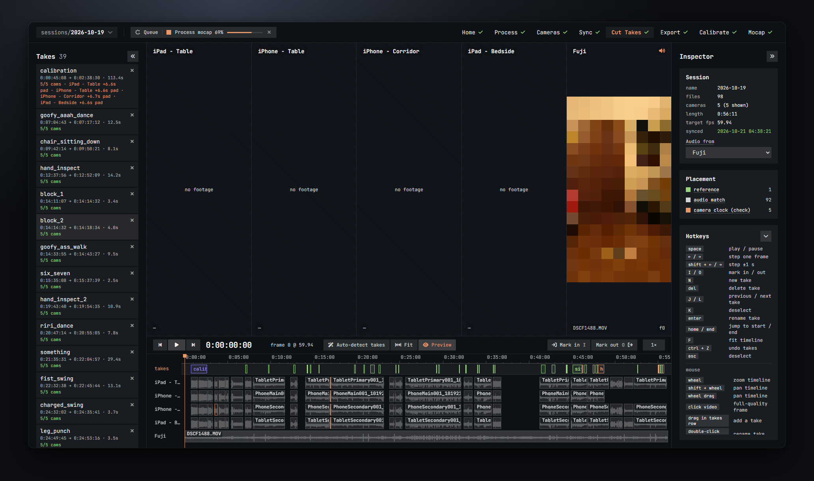
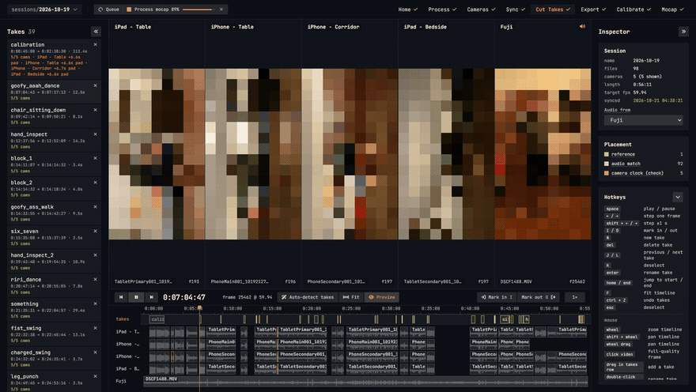
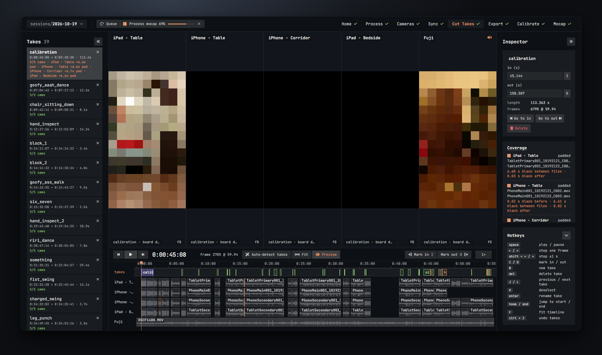
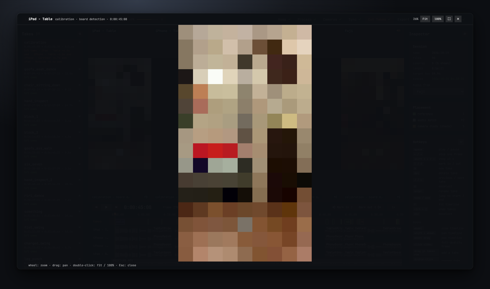

# Cut Takes

Cut Takes is the main screen. You scrub through the whole session with every camera side by side, play it back, and mark the takes you want to export. It is also where you fix a clip that sync put in the wrong place.

## The layout

From left to right, top to bottom:

- **Takes** (left sidebar): the list of takes. Click one to select it and jump to its start.
- **Camera grid** (top): one tile per camera, showing the frame under the playhead. A tile says *no footage* when that camera has nothing at this time, and *proxy building…* over a still frame while the Process step is still making its proxy.
- **Transport** (under the grid): play, the time code, the take buttons and the speed.
- **Timeline** (bottom): a ruler, the takes row, and one lane per camera with its clips and their waveforms. The orange line is the playhead.
- **Inspector** (right): details of what is selected, and the hotkey list.

Each tile shows the camera name, the file name of the clip under the playhead, and the frame number inside that clip (`f2705`). A speaker icon marks the camera you hear.

## Scrubbing and zooming

- Click or drag in the ruler or in a lane to move the playhead.
- The time code under the grid shows the position as `h:mm:ss:ff`, and next to it the frame number at the target frame rate.
- **Wheel** over the timeline zooms around the pointer. **Shift + wheel** pans. Holding the **middle mouse button** and dragging pans too.
- **Fit** (or **F**) shows the whole session again.
- Zoom in far enough and the ruler shows one tick per frame.
- **← / →** step one frame; **Shift + ← / →** step one second; **Home / End** jump to the start and the end.

The clip bars are coloured by how sync placed them: grey for an audio match or the reference, orange for a full search or a camera-clock placement (check those), red for unplaced, blue-violet for a manual offset. The **Placement** window in the inspector counts them and explains each colour on hover.

## Playback

- **Space** or the play button plays from the playhead. Every tile plays its own proxy, kept in step. Play stops at the end of the session.
- The **speed** button cycles 0.25× → 0.5× → 1× → 2×.
- The previous / next buttons around play jump to the previous or next take.

**Audio from** (in the Session window of the inspector, shown when nothing is selected) picks which camera's sound you hear while playing. Choose *muted* for silence. This only affects playback here; exports keep every camera's own audio. By default you hear the reference camera.

## Making takes

Three ways, all equal:

1. **Drag in the takes row.** Press in an empty spot of the takes row, drag, release. The edges snap to clip starts and ends, to other takes and to the playhead. A drag shorter than 0.2 s is treated as a click.
2. **Mark in and out, then N.** Put the playhead where the take starts and press **I** (or **Mark in**). Move to the end and press **O** (or **Mark out**). The marked range shows as a dashed box. Press **N** or click **Add take**. The out mark has to be after the in mark.
3. **Auto-detect takes.** The button proposes takes from the clusters of short clips: the phones start and stop for each take, so each cluster of overlapping phone clips becomes one take. A camera that recorded one long clip for the whole session is ignored for this. Clips less than 2 s apart join the same take. Each take covers the span every camera in the cluster has in common; if that is under a second, it covers the whole cluster instead. If takes already exist the button asks before replacing them, and **Ctrl + Z** brings them back.

New takes are named `take_01`, `take_02`, … continuing from the highest number in use. Rename the calibration take so its name contains `calib` (for example `calibration`); the Calibrate step picks the first such take for you.

## Editing takes

With the mouse on the takes row:

- **Drag a take** by its body to move it. The grab cursor shows where.
- **Drag an edge** to resize it. The edges snap like a new take does.
- **Double-click** a take to rename it. Enter confirms, Esc cancels. Spaces in a name become underscores.
- **Click** a take to select it and show it in the inspector.

With the keyboard, on the selected take:

- **I** and **O** move its in or out point to the playhead.
- **Enter** renames it.
- **Del** (or Backspace) deletes it. The small **x** in the sidebar does the same.
- **J / L** select the previous / next take and jump to its start. With nothing selected they go from the playhead.
- **K** or **Esc** deselect. Esc also clears pending in/out marks.
- **Ctrl + Z** undoes the last take edit: a move, a resize, a rename, a delete, or an auto-detect. There are 60 steps of undo. Undo does not cover offset changes.

A take is at least two frames long. Takes are sorted by their start time, and they save themselves a moment after every change.

## The take inspector

Select a take and the inspector shows two windows.

**The take window**

- Its name, editable in place.
- **in (s)** and **out (s)**: exact start and end in seconds. Type a value, or click the **I** / **O** buttons next to them to set them to the playhead.
- **length** in seconds and **frames** at the target frame rate. This is how long every exported file of the take will be.
- **Go to in** / **Go to out** move the playhead. **Delete** removes the take.

**Coverage**
One row per camera that the export would include, with a coloured square:

- green, **full**: the camera has footage for the whole take.
- orange, **padded**: the camera's footage misses part of the take. On export, black video and silence fill the gap so every file has the take's length. The text under it says how much: *6.60 s black between files · 0.03 s black after*. *black between files* means the camera stopped and restarted inside the take; both clips are used, joined in order.
- red, **no footage — skipped**: the camera has nothing in this take. No file is written for it.

Each row lists the files that feed it. The sidebar shows the same thing in short: *5/5 cams*, or *4/5 cams · Fuji missing · iPad +6.6s pad*.

When you select a take, the timeline shades its span across every lane, so coverage is easy to see at a glance.

## The file inspector

Click a clip bar in a lane to select the file. The inspector then shows:

**The file window**

- camera, length and size, frame rate (orange if it differs from the target, with *VFR* when suspected), audio yes or none, creation time.
- **sync**: how it was placed (*reference*, *audio match*, *full search (check)*, *camera clock (check)*, *unplaced*, *manual*) and through what. Hover for the meaning.
- **why**: the reason behind a fallback, such as *weak audio peak in the window*, *no audio track* or *camera clock not linked*.
- **score**: the strength of its audio match (0 to 1), then how many times stronger it was than the next-best peak.
- **vs clock**: how far the audio placed it from where its camera clock predicts. Within ±W is expected.
- **flags**: problems the sync checks found, such as an overlap with another clip of the same camera.
- **against**: the clip it was matched to.

**Offset**
Where the file starts on the session timeline, in seconds.

- Type a value in **start in session (s)**. The arrow button next to it jumps the playhead to the clip's start.
- The nudge buttons move the clip: **−1 s, −10 f, −1 f, +1 f, +10 f, +1 s** (f = frames at the target rate). Watch the tiles while you do it: at a clap, every camera should hit the same frame.
- Any typed or nudged offset marks the clip as **manual** (blue-violet). Sync will not touch it again unless you tick *re-sync manual files* on the Sync step.

**Re-sync against…**
Pick a placed clip that has audio from the dropdown and click **Go**. The file's audio is matched against that clip at any distance, and the file is moved to the best match. A toast reports the new offset with its score and ratio, and warns *weak match, check it* when the match is poor. The result counts as manual. Use it when looping music matched a clip one bar off, or when a full-search placement looks wrong: pick a clip from the same take on a camera you trust. If the file has no audio you get *this file has no audio — nudge it by eye*.

## Preview

The **Preview** button in the transport swaps FreeMoCap's own videos into the tiles where they exist:

- on a take used for a calibration, the board detection drawn over the picture (the take block turns blue-violet on the timeline),
- on a processed take, the skeleton drawn over the picture (the take block turns green).

Other takes keep the normal video. The first time you turn Preview on, the app builds small copies of FreeMoCap's videos in the background (*Making N preview videos; they show up as they're ready*); the eye icon spins meanwhile. Preview stays on until you turn it off, and is remembered per session.

## The frame viewer

Click any tile to open the frame under the playhead at full quality, straight from the source file (or from FreeMoCap's full-size video when Preview is on). It covers the whole window. The title bar names the camera, the file and the time code, and shows the zoom.

- **Wheel** zooms around the pointer, up to 16×. **Drag** pans.
- **Double-click** switches between fit-to-window and 100 %.
- **0** fits the frame, **1** shows it at actual pixels, **+** and **−** zoom in steps.
- **Fit** and **100%** do the same as the keys. The expand button goes to browser full screen.
- **Esc** or the **x** closes it. Playback pauses when you open it.

Use it to check sharpness, to see whether the board is readable in a calibration take, or to read a frame number on a slate.

## Hotkeys

The **Hotkeys** window at the bottom of the inspector lists them; its chevron folds it away.

| Key | Action |
| --- | --- |
| Space | play / pause |
| ← / → | step one frame |
| Shift + ← / → | step ±1 s |
| I / O | mark in / out (or set the selected take's in / out) |
| N | new take from the marks |
| Del (or Backspace) | delete the selected take |
| J / L | previous / next take |
| K | deselect |
| Enter | rename the selected take |
| Home / End | jump to start / end |
| F | fit the timeline |
| Ctrl + Z | undo take edits |
| Esc | deselect and clear the marks |

| Mouse | Action |
| --- | --- |
| wheel | zoom the timeline |
| Shift + wheel | pan the timeline |
| middle-button drag | pan the timeline |
| click a video tile | full-quality frame viewer |
| drag in the takes row | add a take |
| double-click a take | rename it |
| click a clip bar | select the file, nudge its offset |
| click a take | select it, edit it |

Keys do nothing while you are typing in a box or while a dialog is open.

## Collapsing the sidebar and the inspector

- The **«** button at the top of the Takes sidebar folds it to a thin strip labelled *Takes*; click the strip to bring it back.
- The **»** button next to *Inspector* folds the inspector the same way; the strip reads *Inspector*.
- The **Hotkeys** window folds on its own with its chevron.

All three are remembered in your browser. The camera grid grows to use the space.
