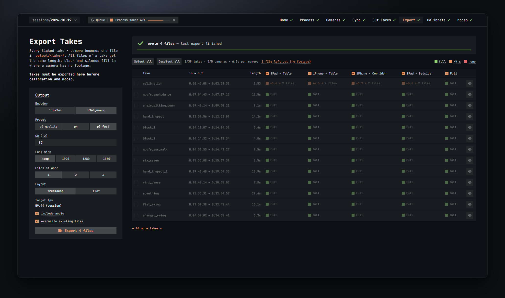

# Export

Export writes every ticked take as one video per camera. All files of a take have exactly the same length, the same frame count and the same frame rate, with the camera's rotation applied. This is the folder layout FreeMoCap reads, and the Calibrate and Mocap steps only see takes that have been exported here.



## The takes × cameras table

One row per take, one column per camera.

- **Tick a row** (or click anywhere on it) to include the take. Untick it to leave it out. **Select all** and **Deselect all** do all rows at once.
- **Click a camera's header** to leave that camera out of every take, and click it again to put it back. A left-out column is dimmed.
- **in → out** and **length** show the take's bounds and duration.
- The **eye** button at the end of a row opens the take in Cut Takes, selected, with the playhead at its start.
- Only the first 13 takes are listed; **+ N more takes** unfolds the rest.

The line above the table sums up what will be written: *39/39 takes · 5/5 cameras · 9:22 per camera*, that is how many takes and cameras are in, and the total length of footage each camera gets. *N files left out (no footage)* counts the camera-take pairs that will be skipped because the camera has no footage there; the take is still exported with its other cameras.

### The coverage cells

Each cell says what that camera has for that take:

| Cell | Meaning |
| --- | --- |
| green, **full** | The camera has footage for the whole take. |
| orange, **+N s** | The camera's footage misses N seconds of the take. Black video and silence fill them, so every file of the take has the same length. *2 files* after it means the camera stopped and restarted inside the take; both clips are joined in order with black for the break. |
| red, **none** | The camera has no footage in this take. No file is written for it. |

Hover a cell to see the files it uses and exactly where the black goes (*6.60 s black between files · 0.03 s black after*).

A take with lots of orange usually means one camera was started late or stopped early. That is fine for FreeMoCap: the padded frames simply have no body in them.

## Output settings

The **Output** card on the left. Hover its title to see the one-line summary of what every file is written as (for example *h264 · crf 17 · yuv420p · 59.94 fps · 1920px long side*). Every setting is saved with the session.

**Encoder**
- **libx264** encodes on the CPU. Always available. The default on machines without a working NVENC.
- **h264_nvenc** encodes on the NVIDIA GPU, much faster at 4K. Only selectable when the NVENC test in Setup passed; new sessions start with it when it did. If the test failed the button is greyed out and, if the session still has it selected, a note tells you to pick libx264.

Both write H.264 video that FreeMoCap and every player read.

**Preset** (NVENC only)
Speed against quality for the GPU encoder: **p5 quality** (default), **p4**, **p3 fast**. At 4K the encoder is the slowest part of an export: p3 is about twice as fast as p5, with slightly bigger files. Pick p3 when you export a lot of 4K and do not need the last bit of quality.

**CRF** (libx264) or **CQ (−2)** (NVENC)
Quality, 0 to 51, default 17. Lower is better quality and bigger files; around 17 is visually lossless for most footage. With NVENC the encoder is sent this value plus 2, which looks about the same as libx264 at the same number, so you can keep one value and switch encoders.

**Long side**
Scales each video down so its longer side is at most this many pixels: **1920** (default), **1280**, **1080**, or **keep** for the source size. It never upscales. 1920 is plenty for FreeMoCap and exports far faster than 4K.

**Files at once**
How many files are encoded in parallel: **1** (default), **2** or **3**. It only helps when the encoder is not already saturated. A GPU with a single NVENC encoder (an RTX 3090, for example) still encodes one file at a time, and libx264 already uses every core, so for most machines 1 is right. Cancel stops all of them.

**Layout**
- **freemocap** (default): `output\<take>\synchronized_videos\<camera>_synced.mp4`. This is what FreeMoCap expects and what the Calibrate and Mocap steps need.
- **flat**: `output\<take>\<camera>_synced.mp4`. Use it only if you feed the files to something else; the Mocap step refuses takes exported flat.

**Target fps**
Shown, not set here: it is the session's target frame rate from the Process step. Every file is conformed to it, with frames dropped or duplicated to match.

**include audio** (default on)
Keeps each camera's audio in its file, with silence where the camera has no footage. Off writes video only.

**overwrite existing files** (default on)
Replaces files already in the output folder. Off keeps them and skips those take × camera files, which is handy when you add one take and do not want to re-encode the rest.

## Exporting

The big button reads **Export N files**, where N is the number of take × camera files that will be written. It says *Nothing to export* when no take is ticked.

While it runs the button turns into **Cancel export** and the banner on the right shows the progress and the file being encoded. The Queue pill shows the same. Cancel keeps the files already written.

When it is done, the banner says:

- *wrote N files — last export finished*: all good.
- *done with N errors — see the job log*: open the Jobs drawer. The usual cause is a file that could not be replaced because another program had it open (see [Tips and limits](09-tips-and-limits.md)).
- *export failed*: the job itself stopped; the log has the reason.
- *export cancelled — files already written were kept*.

Between exports the banner shows what is ticked and when the last export was, for example *189 files from 39 takes ticked — last export 2026-10-20 15:16:25*.

## Where the files land

Inside the session folder:

```
sessions\<name>\output\
  <take>\
    synchronized_videos\
      <camera>_synced.mp4      one per camera that has footage
```

With the flat layout the videos sit straight in `output\<take>\`.

- Take and camera names become folder and file names; characters Windows does not allow are replaced, and two takes with the same name get a `_2` suffix.
- Every file of a take has the same length and the same number of frames: the take's length times the target frame rate, rounded. The export checks each file after writing it and reports a mismatch as an error in the log.
- A re-export overwrites the videos but never deletes FreeMoCap's results that may already sit in the take folder. It does mark a processed take as *stale* on the Mocap step, so you know to run it again.
- The **folder** button on the Mocap step, or **Open session folder** in the header menu, opens these folders in Explorer.
