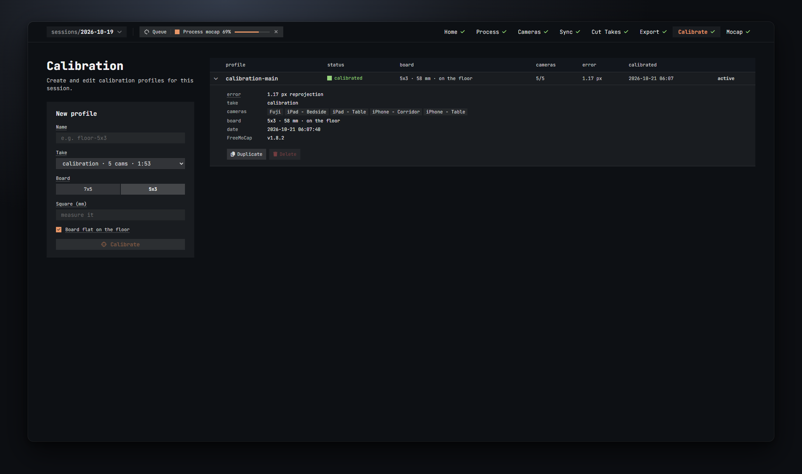

# Calibrate

The Calibrate step runs FreeMoCap's camera calibration on the take in which you filmed the ChArUco board. The result is a *calibration profile*: where each camera stands, how its lens bends the picture, and how well that fits. The Mocap step needs one before it can build a skeleton.

This is FreeMoCap's work, run for you. The step unlocks once at least one take has been exported, and it needs FreeMoCap installed from the Setup card on Home.

## Before you start

- Film the board in its own take. Every camera must see it, from several angles, all at the same time. Walk it slowly through the space the person will move in.
- Cut that take in Cut Takes and give it a name that contains `calib` (for example `calibration`). The form below then picks it for you.
- Export it with the **freemocap** layout (the default). Calibrate only sees exported takes.
- If FreeMoCap is not installed, the page shows *FreeMoCap 1.8.2 isn't installed* with an **Open Setup** button. If nothing is exported yet it says *No exported takes yet — export the calibration take first*, with a button to Export.

## What a calibration profile is

A profile is one board setup and its result:

- the take, the board, the size of its squares, and whether the board lay on the floor,
- once run: the cameras it knows, the reprojection error, and the calibration file itself, kept in `output\calibrations\`.

A session can hold several profiles. One of them is **active**: every take on the Mocap step is processed with it unless you pick another profile for that take. The first profile that calibrates successfully becomes active on its own.

A profile is calibrated once. To try other settings, **Duplicate** it and run the copy.

## The New profile form

The card on the left. Fill it in from top to bottom.

**Name**
What the profile is called in the Mocap step, and the name of its calibration file. Letters, digits, `.`, `_` and `-` are kept; anything else becomes a dash, and the note *saved as …* shows the result. Up to 60 characters. *a profile with this name already exists* keeps the button off until you change it.

**Take**
The exported take in which every camera filmed the board, as *name · N cams · length*. The first exported take with `calib` in its name is preselected. FreeMoCap finds the board in these videos to work out where each camera is and how its lens bends the image.

**Board**
Which printed ChArUco board you filmed: FreeMoCap's **7x5** or **5x3** (squares across and down). It must match the printout, or the board is not detected. The form starts on 5x3.

**Square (mm)**
The edge length of one black square on your printout, measured with a ruler. This sets the scale of everything: all 3D output is in millimetres because of it. A wrong value scales the whole skeleton, and you will see it in the bone lengths on the Mocap step. Measure the real print, not the PDF.

**Board flat on the floor**
Ticked by default. Tick it when the board lay flat on the floor at some point: FreeMoCap then uses it as the ground, so z = 0 is the floor and z points up. Untick it if the board was only held up; then the first camera is the origin and "up" is wherever that camera's up is.

**Calibrate**
Creates the profile and runs it straight away. The button stays off until the name and the square size are filled in; hover it for the reason (*name the profile*, *enter the square size*, *another profile is calibrating*, *wait for mocap processing to finish*). Enter in the Name box does the same. Once the run has started, the form clears for the next profile.

If the take's folder holds videos that were not part of its last export (a camera you have since left out, for example), a dialog lists them: *Delete leftover videos?* FreeMoCap would treat them as extra cameras. **Delete and calibrate** removes them and goes on.

## While it runs

- The profile's row says *calibrating · N%*, and its expanded detail shows the message and a bar: *detecting the board: 42%*. Hover the percentage for what to expect: board detection runs on every frame of every camera, so a 2-minute take can take 10–15 minutes.
- The Queue pill shows the same job. Cancel from there or from the Jobs drawer.
- Only one calibration runs at a time, and not while the Mocap step is processing.

## The profiles table

One row per profile. Click a row to expand it.

| Column | What it shows |
| --- | --- |
| profile | The name. |
| status | *not run* (blue), *calibrating · N%* (orange), *calibrated* (green) or *failed* (red). |
| board | The board, the square size and whether it was on the floor: *5x3 · 58 mm · on the floor*. |
| cameras | Once calibrated, how many cameras the calibration knows out of the take's cameras (*5/5*). Before that, the take's camera count. |
| error | The reprojection error in pixels. |
| calibrated | When it was calibrated. |
| active | *active* on the profile the Mocap step uses by default. |

### What a good reprojection error looks like

The error is how far, in pixels, the detected board corners are from where the calibrated cameras say they should be. Lower is better. Around 1–2 px or less is good; FreeMoCap's own three-camera sample comes out well under 1 px in the self-test.

Above 2 px the expanded profile warns you. The usual causes: a wrong square size, a camera that saw the board only briefly or only from one angle, or a camera that moved during the take. Film the board again and make a new profile.

## The expanded profile

Below the row, for a calibrated profile:

- **error**, **take**, **cameras** (one chip per camera the calibration knows), **board** as it was calibrated, **date** and the **FreeMoCap** version.
- **Set active** makes this the default profile for the Mocap step. It is hidden on the profile that is already active. Takes that follow the active profile and were processed with another one turn *stale* on the Mocap step; process them again.
- **Duplicate** puts its settings into the New profile form under a new name (`<name>-2`). Change what you want and press Calibrate. This is how you retry with another square size or board.
- **Delete** removes the profile and its calibration file, after asking. If takes had picked this profile, they go back to the active one. Takes already processed with it keep their results. The active profile cannot be deleted: make another one active first.

For a profile that has not run, or failed:

- **take** and **board**, then *Not calibrated yet.* or *The calibration failed. The log has the details; run it again, or duplicate it to change the board settings.* with the error underneath.
- **Calibrate** (or **Run again** after a failure) starts it. **Duplicate** and **Delete** as above.
- *Its calibration take isn't exported any more — duplicate it and pick another take.* appears when the take was deleted or renamed and exported under another name.

## Warnings to read

- *The calibration take was re-exported since — duplicate the profile to calibrate it again.* The videos the profile was calibrated from have changed (a new cut, a different rotation or size). The profile still works, but it may not fit the new files. Duplicate and run the copy.
- *Its board settings differ from this calibration — duplicate it to calibrate them.* The profile's board or square size no longer match what it was calibrated with. Duplicate and run the copy.
- *Above 2 px: check the square size, that every camera saw the board, and that no camera moved.* See above.
- *Ground plane alignment failed, camera 0 is the origin.* The board was ticked as lying on the floor, but FreeMoCap could not use it as the ground. The calibration is still usable; the floor is just not at z = 0. Film the board flat on the floor, clearly visible to every camera, or untick the box.

## After calibrating

- In Cut Takes the calibration take turns blue-violet on the timeline, and **Preview** shows FreeMoCap's board detection drawn on each camera. Use it to check that the corners were found everywhere.
- Go to the Mocap step. Its Active calibration card repeats the profile, and the takes table shows how each take's cameras match it.
- Keep the camera names you had when you calibrated. A renamed camera is a camera the profile does not know, and the Mocap step will refuse the take.
- A camera that recorded the calibration take at one resolution and other takes at another is handled for you; see *calibration adjustment* in [Mocap](08-mocap.md#details).
