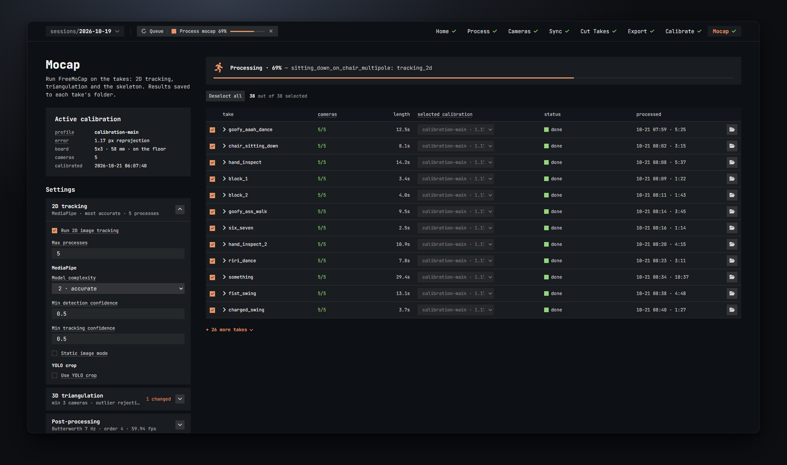
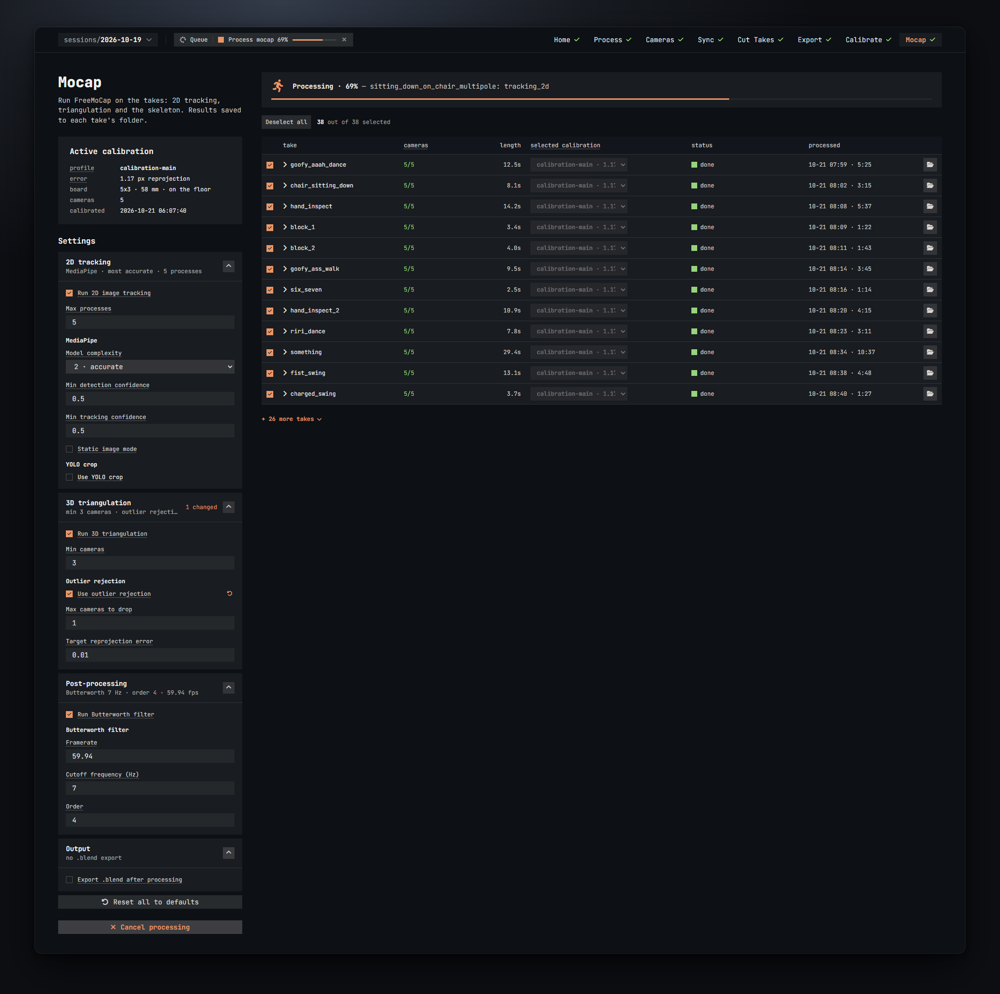
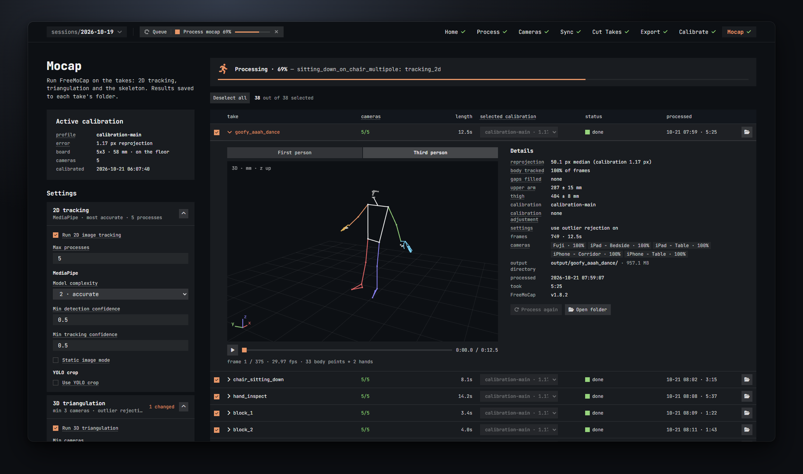
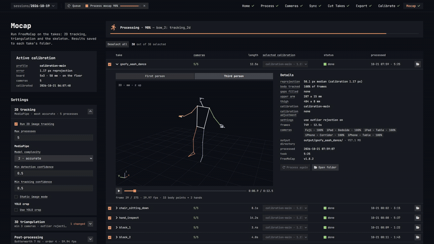
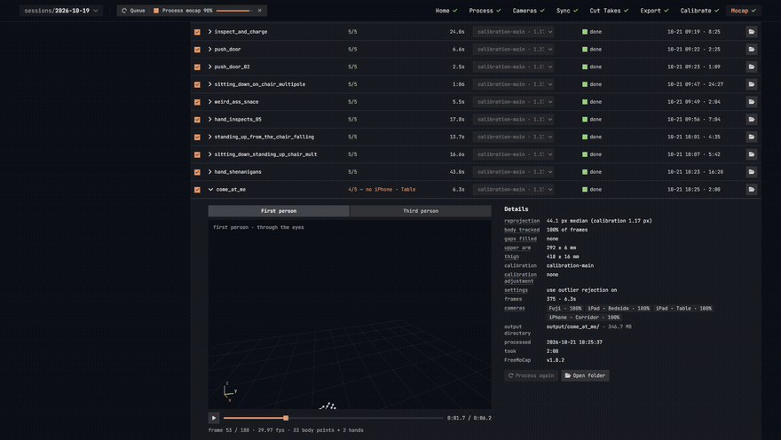

# Mocap

The Mocap step runs FreeMoCap 1.8.2 on your exported takes: 2D tracking of the body in every video, 3D triangulation with the calibration, then smoothing and the skeleton. The results land in each take's folder, and you can look at the skeleton right here.

This is FreeMoCap's work, run for you with the settings below. The step unlocks once a take is exported. It needs FreeMoCap installed (Setup card on Home) and at least one calibrated profile ([Calibrate](07-calibrate.md)).



## The layout

- Left: the **Active calibration** card, the **Settings**, and the **Process selected** button.
- Right: the progress banner and the **takes table**. Click a take's name to open its detail: the skeleton viewer and the numbers.

If FreeMoCap is missing the page shows a card with an **Open Setup** button. If nothing is exported it says *No exported takes yet*, with a button to Export. If only calibration takes are exported, the table says so: export some takes to process.

## Active calibration

The profile every take is processed with unless you pick another one in the table:

- **profile**, its reprojection **error**, the **board**, how many **cameras** it knows (hover for their names), and when it was **calibrated**.
- *Its calibration take was re-exported since* or *Its board settings changed since it was calibrated*: go to the Calibrate step, duplicate the profile and run the copy.
- No profile yet, or none calibrated: the card says so, with an **Open Calibrate** button.

## Settings



FreeMoCap's processing settings, in four windows: **2D tracking**, **3D triangulation**, **Post-processing** and **Output**. Each window's header shows a one-line summary of what it is set to (*MediaPipe · most accurate · 5 processes*, *min 3 cameras · no outlier rejection*, *Butterworth 7 Hz · order 4 · 59.94 fps*, *no .blend export*), a **N changed** badge when you have changed something in it, and a chevron to fold it. Which windows are open is remembered in your browser; 2D tracking starts open.

- Hover a setting's name for what it does.
- A setting you have changed gets a small arrow next to its name; hover it to see the default, click it to go back.
- **Reset all to defaults** appears at the bottom when anything is changed.
- Settings are saved with the session a moment after you change them. They apply to every take you process from then on. Takes already processed with other settings turn **stale** in the table, so you know which ones to run again.

The first toggle of each window turns the whole stage on or off. With a stage off, its other settings hide and the summary reads *off · reuses the last 2D data*, *off · reuses the last 3D data* or *off · no filtering*: FreeMoCap then loads what the take's last run produced and only runs the later stages. A take that has never been processed cannot skip a stage; the Process button tells you (*2D tracking is off, but it has no earlier 2D data*).

The defaults are FreeMoCap's own, except the filter's framerate, which Batlejka sets to your session's frame rate.

### 2D tracking

**Run 2D image tracking** (on)
Find the body in every frame of every video with MediaPipe. This is the slow part. Turn it off to re-run triangulation or the filter with new settings, or with another calibration, without tracking again.

**Max processes** (default: one per camera of the takes, at most your CPU count minus one; the tip tells you both numbers for this PC)
How many videos are tracked at the same time. Each process takes a CPU core and memory. More than one per camera does not help. Lower it if the machine runs out of memory or you want to keep using it meanwhile.

**MediaPipe**

- **Model complexity** (2 · accurate): which pose model runs. 0 is light and fast, 1 balanced, 2 the heavy, most accurate one. Drop to 1 for a quick look at a long take.
- **Min detection confidence** (0.5): how sure MediaPipe must be before it reports a person in a frame. Higher drops doubtful detections; lower keeps more frames, and more mistakes.
- **Min tracking confidence** (0.5): how sure it must be to keep following the person from the previous frame; below it, it searches the whole frame again.
- **Static image mode** (off): treat every frame as an unrelated photo and detect from scratch each time instead of tracking. Slower; can help with very fast motion.

**YOLO crop**

- **Use YOLO crop** (off): find the person with a YOLO detector first and run MediaPipe on that crop only. Helps when the person is small in the frame, such as a wide shot from a far camera. Slower, and MediaPipe then always runs in static image mode.
- **YOLO model size** (nano): nano, small, medium, large, extra large or high res. Bigger finds people more reliably and runs slower.
- **Buffer bounding box** (by box size): what the margin around the detected person is a percentage of: the box itself, or the whole image.
- **Buffer percentage** (10): the margin added around the person before cropping, so hands and feet near the edge of the box are not cut off.

### 3D triangulation

**Run 3D triangulation** (on)
Combine the cameras' 2D points into 3D with the calibration. Off: reuses the take's 3D data from its last run and only post-processing runs again.

**Min cameras** (3)
A point is only placed in 3D when at least this many cameras see it; otherwise it is left empty for that frame and post-processing fills the gap by interpolation. The box will not go above the largest camera count among your takes, and FreeMoCap caps it at each take's own count. With two cameras set it to 2. Lower means fewer gaps and less accurate points; higher means cleaner points and more gaps.

**Outlier rejection**

- **Use outlier rejection** (off): when a point's reprojection error is above the target, also triangulate it without one or more cameras and blend the results, favouring the combinations that agree best. Slower. Try it when one camera sometimes gets the body wrong (a mirror, a doorway, the person half hidden).
- **Max cameras to drop** (1): how many cameras it may leave out of one point. It never goes below Min cameras.
- **Target reprojection error** (0.01): the error at which a point counts as good enough and no camera is dropped, in normalized image units, not pixels: 0.01 is about 1 % of the image.

### Post-processing

**Run Butterworth filter** (on)
Smooth the 3D trajectories with a low-pass filter to remove jitter. Gaps are filled by interpolation either way.

**Butterworth filter**

- **Framerate** (your session's target frame rate, for example 59.94): the frame rate the filter assumes. It must match the footage. FreeMoCap's own default is 30, which on 59.94 fps footage would double the real cutoff; Batlejka fills in the right value, so leave it.
- **Cutoff frequency (Hz)** (7): motion faster than this is smoothed away. Lower is smoother but blunts quick moves. It must stay below half the framerate; a red note appears and Process is blocked if it does not.
- **Order** (4, from 1 to 8): how sharply the filter cuts above the cutoff. Higher is steeper.

### Output

**Export .blend after processing** (off)
After processing, FreeMoCap runs Blender in the background and saves the take's skeleton as a `.blend` file in the take's folder. Needs Blender installed; adds time per take. The take detail then gets an **Open in Blender** button.

**Blender path**
The `blender.exe` to use. Leave it empty and FreeMoCap looks for an installed Blender itself.

## The takes table

Every exported take except the calibration takes (the ones a profile uses). The first 12 are listed; **+ N more takes** unfolds the rest.

Above the table: **Select all** / **Deselect all**, and *N out of M selected*. The ticks are remembered with the session.

| Column | What it shows |
| --- | --- |
| tick | Process this take. Grey when it cannot be; hover the row for why (*flat layout: FreeMoCap needs synchronized_videos/*, or *videos are missing — export the take again*). |
| take | The name. Click it to open the detail. Hover it for the take's folder. |
| cameras | How many of the take's cameras its calibration profile knows. See below. |
| length | The take's length. |
| selected calibration | The profile this take is processed with. It follows the active profile unless you pick another one here. |
| status | Where the take stands. See below. |
| processed | When it was last processed and how long the run took (*10-21 06:31 · 3:02*). Hover for the full date. |
| folder | Opens `output\<take>\` in Explorer. |

### The cameras column

- Green *5/5*: every camera of the take is in the calibration.
- Orange *4/5 — no Fuji*: the take has fewer cameras than the calibration (that camera had no footage in the take). It is processed with the matching part of the calibration; the status then says *done · subset*.
- Red *not in <profile>: iPhone*: the take has a camera the profile does not know. This blocks processing. It happens when a camera was renamed after calibrating, or added later, or the wrong profile is selected. Pick another profile, or calibrate a profile from a take that has every camera.
- Red *1/5 — needs at least 2 cameras*: FreeMoCap cannot triangulate with one camera.
- Red *flat layout — export it again*: the take was exported with the flat layout. Export it with the freemocap layout.
- Plain *5 cameras*: there is no calibrated profile to compare with yet.

Two tags can follow the count:

- **N leftover** (orange): videos in the take's folder that were not part of its last export, for example a camera you have since left out. FreeMoCap would process them as extra cameras, so you are asked to delete them when you process.
- **N missing** (red): exported videos that are no longer on disk. Export the take again.

### The selected calibration dropdown

Lists every profile as *name · error (active)*. Profiles that are not calibrated are greyed out. Picking the active profile means "follow the active one", also when the active profile changes later; hover the box to see *follows the active profile* or *picked for this take*. It is locked while a run is going. With no profiles at all it reads *no calibration*.

### The status column

| Status | Meaning |
| --- | --- |
| not processed (grey) | Never run. |
| queued | Waiting its turn in the current run. |
| *stage* · N% (orange, with a small bar) | Running: *downloading*, *detecting the board*, *2D tracking*, *triangulating*, *skeleton*, *saving*, *Blender export*. |
| done (green) | Processed, and nothing has changed since. |
| done · subset | Processed with only the cameras this take has; FreeMoCap used the matching part of the calibration. |
| stale (orange) | Processed, but something changed since; the reason is next to it: *videos re-exported*, *calibration changed*, *other calibration selected*, *processing settings changed*, or its results folder is gone. Process it again to update the results. |
| failed (red) | The run failed; the error is next to it and in the Jobs drawer. |

## Process selected

The big button reads **Process N selected**. When it is off, hover it: *Tick the takes to process*, *A calibration is running*, *<take>: no calibrated profile — run one on the Calibrate step*, *<take>: a camera isn't in its calibration*, *<take>: needs at least 2 calibrated cameras*, the Butterworth cutoff note, or a stage that is off with no earlier data.

- If any ticked take has leftover videos you get the *Delete leftover videos?* dialog; **Delete and process** removes them and starts.
- The takes run one after the other in a single job. The banner shows *Processing · N% — <take>: <stage>* with a bar; each take's status shows its own stage and percentage. The Jobs drawer carries FreeMoCap's own log.
- The button turns into **Cancel processing**. Takes that had finished keep their results; the one that was running is left as it was, so process it again later.
- Tracking runs MediaPipe on the CPU: a one-minute take with five cameras takes several minutes. The *processed* column shows how long each take took.
- Afterwards the button area says *Last run failed: …* or *Last run cancelled.* if that happened.

Between runs the banner sums up: *2 of 37 takes processed — 1 ran on a camera subset · 1 stale · 1 failed*, or, before anything is done, *tick takes and process them* / *calibrate a profile first*.

## The take detail



Click a take's name. The row opens into two parts: the skeleton viewer on the left and **Details** on the right. A take that is not processed yet shows *No skeleton yet: process this take to see it here.* instead of the viewer (or *Processing — the skeleton shows up here when it's done.*).

### The skeleton viewer



FreeMoCap's 33 body points, plus the two 21-point hands when FreeMoCap wrote them, in millimetres, on a floor grid of half-metre squares. Bones are coloured by body part so you can tell left from right at a glance: the left side is cool (green arm, sky-blue hand, blue-violet leg), the right side warm (orange arm, amber hand, red leg); the torso is white and the face grey. The small axes in the corner show which way x, y and z point in the current view.

- **Third person** (default) looks at the person from outside. Drag to orbit, wheel to zoom, double-click to reset the view. The corner reads *3D · mm · z up* when the calibration had the board on the floor.
- **First person** looks out of the person's eyes, following the head. Drag to look around; double-click to look straight again. The face points are hidden so they do not block the view.

  
- The play button, the frame slider and the time (*0:00.0 / 0:08.1*) are under the picture; the caption reads *frame 1 / 244 · 29.97 fps · 33 body points + 2 hands*. The viewer plays at most 30 frames per second: on 59.94 fps footage it shows every other frame, which is why the caption says 29.97.
- Keys, once you have clicked in the viewer: **Space** plays and pauses, **← / →** step one frame, **Shift + ← / →** step one second, **Home / End** jump to the start and the end.
- A point FreeMoCap could not place is held where it was last seen, so the skeleton never falls apart on screen. The Details tell you how many gaps there were.
- Which view you use is remembered in your browser.

### Details

Hover an underlined name for its explanation.

- **reprojection**: *55.7 px median (calibration 1.17 px)*. The median distance, in pixels, between where each camera saw a body point and where its 3D position projects back into that camera, over all frames and cameras. Lower is better. Compare takes with each other: one far above the rest, or a jump after a change, means something is off (a camera moved, the wrong profile, a changed resolution).
- **body tracked**: *100% of frames*. Frames in which all 33 body points got a 3D position before gap filling.
- **gaps filled**: *none*, or *N frames · longest M*: frames where a point had no 3D position and post-processing filled it by interpolation, and the longest such run.
- **upper arm** and **thigh**: *264 ± 25 mm*. Left shoulder to elbow and left hip to knee over the take, as the median and half the spread. A steady length means steady tracking. The value itself checks the square size you entered when calibrating: measure the person with a tape and compare.
- **calibration**: the profile the take was processed with, and *(another profile is selected now)* if the dropdown has since changed.
- **calibration adjustment**: *none* when every camera's video in this take has the size that camera was calibrated at. Otherwise one line per camera that was adjusted: *iPhone - Table: calibrated at 3840×2160, this take is 1920×1080 · lens parameters scaled ×0.5*. This happens when a camera was calibrated at one resolution (say 4K) and recorded this take at another (1080p). The calibration describes the lens in pixels of the calibrated size; used as is on frames of another size, every point of that camera would land in the wrong place and the skeleton would come out broken. Batlejka scales the focal length and image centre to the take's resolution before triangulating, per take, automatically; the job log notes it too. Nothing to do; the line is there so you know it happened.
- **settings**: *defaults*, or the FreeMoCap settings this take was run with where they differ from today's defaults (*model complexity balanced · use yolo crop on*).
- **frames**: *487 · 8.1s*.
- **cameras**: one chip per camera. After processing each one shows the share of frames in which MediaPipe found the body (*Fuji · 100%*). A camera well below the others did not see the person properly: check its framing and light.
- **output directory**: `output\<take>\` and the size of what FreeMoCap wrote.
- **processed**, **took**, **FreeMoCap**: when, how long, and which version. A failed take shows **failed** and the **error** instead.

The buttons under the details:

- **Open in Blender**: only when the take has a `.blend`. Opens it with the program Windows associates with `.blend` files.
- **Process again** (or **Process this take** before the first run): runs just this take with the current settings. Off while a job runs, with the same reasons as the big button.
- **Open folder**: the take's folder in Explorer.

## Where results go

Inside the session folder, next to the exported videos:

```
sessions\<name>\output\<take>\
  synchronized_videos\     your export (FreeMoCap's input)
  output_data\             the 3D data: the body points per frame, the skeleton,
                           center_of_mass\, and raw_data\ (what the "off" stages reuse)
  annotated_videos\        one video per camera with the skeleton drawn on it
                           (this is what Preview shows in Cut Takes)
  <take>.blend             when Export .blend was on
```

- The calibration profiles live in `output\calibrations\`, and a calibration take gets a `charuco_annotated_videos\` folder with the board detection drawn on each camera.
- Exporting a take again replaces its videos but never deletes `output_data\`. The take is marked *stale* instead, so you can decide when to run it again.
- Processing a take again overwrites FreeMoCap's results for that take.
